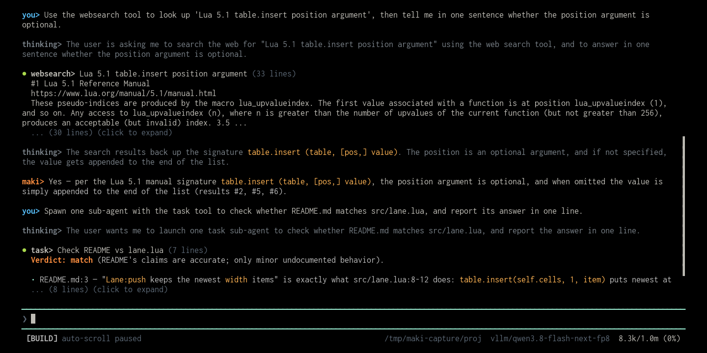

# searxng



A `websearch` tool backed by your own [SearXNG](https://docs.searxng.org/)
instance. Maki ships a `websearch` tool of its own that talks to a hosted service
and needs an API key. This one talks to a server you run, under the same tool
name, so nothing else in your configuration or your prompts has to change. The
package is named `maki-searxng` and the tool it registers is named `websearch`.

## Install

Put this line in your global `~/.config/maki/init.lua`:

```lua
maki.pack.add({ "https://github.com/g4bwy/maki-searxng" })
```

Start maki in a terminal. It asks whether to install the package, then asks about
the permissions in [`plugin.toml`](plugin.toml).

## Turn the builtin off

Maki loads its own plugins before any package, and the second claimer of a tool
name is the one that fails. So with the builtin `websearch` plugin still on, this
package registers nothing and you keep the hosted search. Disable it in
`maki.setup`:

```lua
maki.setup({
  plugins = { websearch = { enabled = false } },
})
```

Then make sure the override took effect. This prints `override active`:

```sh
maki prompt --tools | grep -q SearXNG && echo "override active"
```

No output means the builtin still owns the name.

## Requirement

You need a SearXNG instance that answers `format=json`. That is off by default,
and a request for a format the instance does not list returns `403`. Turn it on in
the instance `settings.yml`:

```yaml
search:
  formats:
    - html
    - json
```

Test it from the shell before you look at the plugin:

```sh
curl 'http://localhost:8888/search?q=maki&format=json' | head -c 200
```

## Configuration

| Setting | Default | Where you set it |
|---------|---------|------------------|
| Instance URL | `http://localhost:8888` | the `SEARXNG_URL` environment variable |
| Request timeout | 10s on `fast`, 30s on `deep` | `PROFILES` in `plugin/init.lua` |
| Result count | 8 per call | the `num_results` tool argument |
| Language | the instance default | the `language` tool argument |

The plugin reads `SEARXNG_URL` from the environment maki starts in, once per
search:

```sh
SEARXNG_URL=http://searx.lan:8888 maki
```

## Allowlist a LAN host

Maki upgrades `http://` to `https://` and refuses private, loopback, and
link-local addresses, because a page the model reads could otherwise point it at
your internal network. A host in `net.allowed_private_hosts` is exempt from both
rules, since a service on your LAN usually has no certificate. Every redirect hop
is checked again against the same list.

```lua
maki.setup({
  net = { allowed_private_hosts = { "localhost:8888" } },
})
```

A public HTTPS instance needs neither the allowlist nor the plain `http`
exception.

## Usage

| Argument | Type | Notes |
|----------|------|-------|
| `query` | string | Required. |
| `num_results` | integer | Defaults to 8. SearXNG returns far more, and the plugin trims. |
| `language` | string | A SearXNG language code, for example `en`, `de`, `zh-CN`. Omit it for the instance default. |
| `profile` | string | `fast`, which is the default, or `deep`. See [Profiles](#profiles). |

The plugin always sends `categories` explicitly and pins `pageno` to 1, so there
is no paging and no image category. Output is truncated by
`agent.max_output_lines` and `agent.max_output_bytes`, like any other tool.

## Permissions

| Key | Used by |
|-----|---------|
| `net` | `maki.net.request()` for the search. The tool also declares `permission = "net"` with `permission_scopes = "query"`, mirroring the builtin, so each prompt names the query. `permission_scopes` without `permission` is a registration error, so the pair is not optional. |
| `env` | `maki.uv.os_getenv()` for `SEARXNG_URL`. |

The manifest names no `net_hosts` list, because the instance is whatever your
`SEARXNG_URL` says. To pin it, add the list to your copy:

```toml
[permissions]
net = true
env = true
net_hosts = ["searx.acme.dev"]
```

No `run` permission is needed: requests go through `maki.net`, not through
`curl`.

## Layout

```text
plugin.toml       permissions the package asks for
plugin/init.lua   the tool: URL, request, formatting, truncation
screenshot.png    the cover image
README.md
```

## Profiles

`profile` picks the engine set, and with it the timeout.

| Profile | Sent as | Timeout | Engines |
|---------|---------|---------|---------|
| `fast` (default) | `categories=general` | 10s | bing, duckduckgo, google cse, mojeek, seznam, wikipedia, wikidata, yahoo, yandex. About a second when warm. |
| `deep` | `categories=deep` | 30s | arxiv, brave, fynd, google news, qwant, reuters, semantic scholar, startpage, startpage news, wiby. News, academic, and browser-backed. |

Use `deep` when a `fast` search came back thin, or when the query needs news,
academic literature, or obscure coverage. Otherwise stay on `fast`, because `deep`
costs 3 to 25 seconds and its engines are the ones most likely to fail.

Two things about `deep` are instance-side and cannot be fixed from the plugin:

- Several `deep` engines (startpage, startpage news, qwant) sit behind scraping
  protection and answer only when the instance has a browser-solving plugin
  configured. Without one they show up as failed.
- SearXNG parks an engine for 30 to 120 seconds after it errors, so back-to-back
  `deep` searches report a shifting note. A changing note is expected, not a fault.

`language` biases ranking, and it does not translate. A search for
`latest news today` with `language=zh-CN` returns CNN. A search for Chinese
weather terms returns Chinese government and weather sites. To get results in a
language, query in that language and treat `language` as a nudge.

## Reported failures

When engines fail, SearXNG fills in `unresponsive_engines`, and the plugin appends
it to the output:

```text
[unresponsive engines] qwant: timeout, startpage: Suspended: CAPTCHA
```

Fewer engines means a narrower result pool, which usually explains results that
look unrelated to the query. `Suspended: CAPTCHA` means that engine needs an
instance change. The note is absent when every engine answers, so a healthy
instance costs nothing.

A transport error, a non-2xx status with a 200-byte body preview, and unparseable
JSON each come back as a tool error rather than an empty result list. An instance
that stalls on upstream engines surfaces as a timeout once the profile budget
runs out.

## Update, disable, remove

```text
/packupdate maki-searxng
/packupdate! maki-searxng
```

Set `plugins["maki-searxng"] = { enabled = false }` to keep this package installed
but inactive. That key is the package, and is not the same thing as
`plugins.websearch`, which is maki's own builtin: you want the builtin off and this
package on. To remove the package, delete its `maki.pack.add` line, reload, then run
`/packdel maki-searxng`.

## Development install

```sh
mkdir -p ~/.local/share/maki/site/pack/dev/start
ln -sfn "$PWD" ~/.local/share/maki/site/pack/dev/start/maki-searxng
```

Run `/reload` after each edit.
